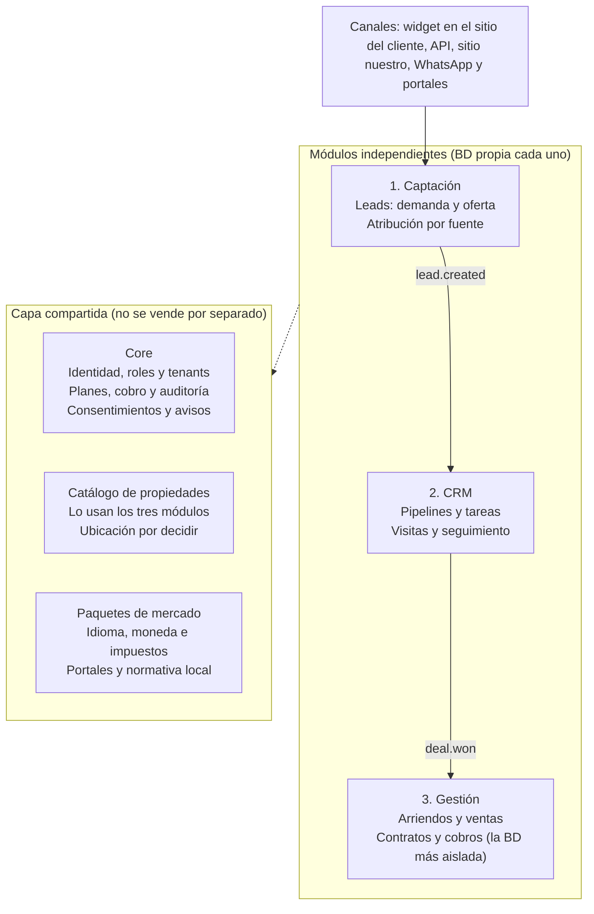
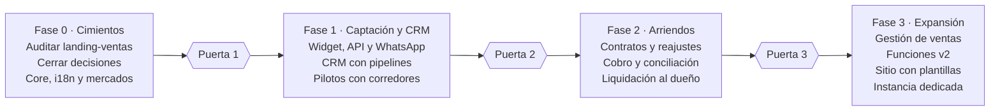

# Blueprint – Plataforma modular para corredores de propiedades

Versión: 2026-10-30 · Estado: borrador para auditoría y arranque de desarrollo

---

## 0. Cómo usar este documento con Claude Code

Este archivo es el contexto base del proyecto. Cárgalo al inicio de cada sesión (por ejemplo, copiándolo como `CLAUDE.md` en la raíz del repositorio o referenciándolo con `@BLUEPRINT.md`).

**Primera tarea: auditar la carpeta `landing-ventas`** (sección 15). Instrucciones para Claude Code:

1. Leer el código sin modificarlo.
2. No abrir ni reproducir el contenido de archivos de secretos (`.env`, claves, tokens); solo informar si existen y si están versionados.
3. Entregar un archivo `AUDITORIA.md` con: mapa de componentes, decisión por componente (reutilizar, adaptar o descartar), módulo destino y riesgos de seguridad detectados.
4. No ejecutar comandos destructivos ni instalar dependencias sin avisar antes.

**Reglas de arquitectura (no negociables) al construir cualquier cosa:**

- Ningún módulo contiene lógica ni datos específicos de un país; todo lo local vive en un paquete de mercado (sección 6).
- Ningún texto visible al usuario va escrito en el código; todo pasa por archivos de traducción (sección 7).
- Cada módulo tiene su propio esquema de base de datos y no hace consultas a las tablas de otro; se comunican por eventos e identificadores (sección 4).
- Cada tabla y cada evento lleva `tenant_id`; el aislamiento por tenant se aplica en la base de datos (sección 13).
- Cada monto se guarda con su moneda explícita.
- Las pantallas se diseñan primero para móvil y se expanden a escritorio (sección 11).
- Toda funcionalidad se expone por API documentada; ninguna pantalla accede directo a la base de datos.

---

## 1. Resumen ejecutivo

**Recomendación: una plataforma SaaS multi-tenant, modular por producto, con una capa de conexión (widget, API y dominio propio) para que cada corredora la enlace a su sitio web actual.** No se recomienda vender una aplicación instalable en la infraestructura de cada cliente.

- **Ingreso recurrente y control:** una sola versión que mantener, parchear y asegurar; el cliente no depende de su propia infraestructura.
- **Integraciones resueltas una vez:** WhatsApp Business, portales, formularios de Meta y Google, firma electrónica y facturación se integran en la plataforma, no cliente por cliente.
- **Conexión con la web existente sin instalar nada:** se pega un script o se consume la API; quien no tiene sitio usa uno creado por nosotros.
- **Modularidad real:** Captación, CRM y Gestión son servicios con base de datos y API propias, que se comunican por eventos con identificadores mínimos. Se venden por separado y un incidente en uno no expone los datos de los otros.

**Alcance de mercado:** el producto parte en Chile pero se diseña para cualquier mercado. Idioma, moneda, normativa e integraciones viven en paquetes de mercado, y las pantallas se piensan primero para móvil, con una consola completa para escritorio.

**Primer producto a lanzar:** Core + Captación + CRM. Gestión de arriendos y ventas va después. La auditoría de `landing-ventas` queda pendiente hasta poder acceder a la carpeta.

---

## 2. Decisión de arquitectura

**SaaS multi-tenant gana en ingreso, seguridad y costo de soporte; la instalación por cliente solo tendría sentido como instancia dedicada para clientes grandes, más adelante.**

| Opción | Cómo se vende | Soporte y actualizaciones | Seguridad de datos | Integraciones (WhatsApp, portales, pagos) | Veredicto |
| --- | --- | --- | --- | --- | --- |
| A. SaaS multi-tenant | Suscripción mensual por módulo | Una sola versión; se actualiza para todos a la vez | Controlamos el aislamiento por tenant, el cifrado y la auditoría | Se integran una vez y las usan todos los clientes | **Recomendada** |
| B. Instalable en la infraestructura del cliente | Licencia o venta única | Cada cliente queda en una versión distinta; soporte caro | Depende de la infraestructura del cliente, que no controlamos | Se repiten por instalación, con claves y webhooks propios | Descartada |
| C. Híbrido: SaaS + instancia dedicada | Plan premium para corredoras grandes | Mismo código, despliegue aislado por cliente | Aislamiento total, datos en entorno separado | Igual que A, con configuración por instancia | Fase posterior |

La decisión se reevalúa si varias corredoras grandes exigen alojar los datos en su propia nube. Para dejar esa puerta abierta, el código no debe asumir un solo despliegue: configuración por entorno y migraciones automatizadas desde el primer día.

---

## 3. Arquitectura macro

**Tres módulos independientes, cada uno con su base de datos, se conectan solo por eventos y comparten una capa común mínima.**



Los eventos `lead.created` y `deal.won` son el único vínculo entre módulos. Todos usan el Core para identidad, planes y auditoría, y referencian las propiedades por identificador; si un módulo se vende solo, los otros pueden no existir.

---

## 4. Multi-tenancy y jerarquía de usuarios

**Cada corredora es un tenant con roles anidados: administrador, jefe de equipo, agente y vendedor (subagente).** Cada rol ve sus propios datos y los de los niveles que contiene.

```
Corredora (tenant) ─ el administrador ve todo y activa módulos y planes
└── Equipo o sucursal ─ el jefe de equipo ve los datos de su equipo
    └── Agente ─ ve sus propios leads, contactos y propiedades
        └── Vendedor o asistente (subagente) ─ ve solo lo que el agente le asigna

Fuera de la jerarquía, con acceso solo a sus propios datos:
Propietario e inquilino ─ portal del módulo Gestión
```

Técnicamente, cada registro lleva `tenant_id`, `team_id` y `owner_id`, y cada rol tiene permisos por módulo (ver, crear, editar, exportar). Un vendedor puede usar el CRM sin acceso a la parte financiera de Gestión. Propietarios e inquilinos no son usuarios de la corredora: entran por un portal con acceso solo a sus propios datos.

---

## 5. Módulo 1 – Captación de leads

**Captación convierte visitas y anuncios en contactos calificados, y distingue desde el origen entre leads de demanda (comprador o arrendatario) y de oferta (propietario que quiere vender o arrendar).**

| Capacidad | Detalle | Fase |
| --- | --- | --- |
| Widget embebible | Formularios, botón de WhatsApp y buscador de propiedades; se pega con un script en cualquier sitio web | MVP |
| API pública y webhooks | Para sitios a medida o landings externas; clave de acceso por tenant | MVP |
| WhatsApp Business | La conversación entrante queda registrada como lead | MVP |
| Ingesta de portales | Consultas por correo, API o feed según el portal (por validar); en Chile: Portal Inmobiliario, Yapo, TocToc y Mercado Libre | MVP por correo, v2 por API |
| Atribución | Fuente, campaña (UTM) y propiedad consultada en cada lead | MVP |
| Alerta de respuesta | Aviso si el lead no es contactado dentro del plazo definido | MVP |
| Sitio propio con plantillas | Fichas de propiedades, SEO básico y dominio propio, para corredoras sin web | v2 |
| Formularios de Meta y Google Ads | Importación automática de leads de campañas | v2 |
| Deduplicación y scoring | Une contactos repetidos por correo o teléfono y puntúa la intención | v2 |
| Valorizador de propiedades | "¿Cuánto vale mi propiedad?" para captar propietarios | v2 |

**Salida hacia otros módulos:** el evento `lead.created` con identificador, tipo, fuente y propiedad. Los datos de contacto viajan cifrados al CRM; los módulos no comparten tablas.

**Métricas del módulo:** leads por fuente, costo por lead y tiempo de primera respuesta.

---

## 6. Visión global y paquetes de mercado

**El producto es global por diseño: los módulos no contienen nada específico de un país, y todo lo local vive en "paquetes de mercado" que se activan por tenant.** Chile es el primer paquete, no el límite del producto.

| Qué varía por mercado | Cómo se resuelve | Ejemplo en Chile |
| --- | --- | --- |
| Idioma y formatos | Locale por tenant y por usuario (sección 7) | Español, fecha día/mes/año |
| Moneda y unidades | Moneda de la cuenta, unidades de reajuste configurables y superficie en m² o pies² | Pesos (CLP), UF, m² |
| Documento de identidad | Campo con tipo y validador por país | RUT |
| Direcciones | Esquema de dirección por país, con mapa y geocodificación | Región, comuna, calle |
| Marco de privacidad | Reglas de consentimiento, plazos y derechos por paquete | Ley 21.719 |
| Portales de propiedades | Un conector por portal (correo, API o feed) | Portal Inmobiliario, Yapo, TocToc, Mercado Libre |
| Mensajería | Canales por mercado; WhatsApp como canal inicial en Latinoamérica, con plantillas aprobadas por idioma | WhatsApp |
| Facturación e impuestos | Conector con la autoridad tributaria local para documentos electrónicos | SII |
| Contratos y trámites | Plantillas y flujos revisados por un abogado local | Contrato de arriendo, escritura, notaría y conservador |
| Reajustes de arriendo | Índices configurables, con fuente de datos por país | UF, IPC |
| Pagos | Pasarela y métodos de pago locales | Por definir |

**Regla de diseño:** ningún módulo importa código de un país. Pide al paquete de mercado, a través de una interfaz, la validación de documentos, los índices, las plantillas o el conector. Un mercado nuevo es un paquete nuevo, sin cambios en Captación, CRM ni Gestión.

**Orden de expansión propuesto:**

1. Chile como primer paquete y mercado piloto.
2. Un segundo mercado de habla hispana, elegido para probar que la abstracción funciona antes de abrir más (candidatos a evaluar: México, Colombia, Perú y Argentina; criterios: tamaño del mercado, parecido de los procesos y acceso a corredores piloto).
3. Mercados con otros idiomas, apoyados en la misma capa de internacionalización.

**Antes de vender en un país nuevo** se valida con un abogado local el tratamiento de datos y los contratos, y se confirma qué portales, sistemas de facturación y pasarelas de pago existen y cómo se integran.

---

## 7. Idioma e internacionalización

**Todo texto, formato y mensaje depende del locale: el primer lanzamiento sale en español e inglés, y la base permite sumar idiomas sin cambiar código.** Hacerlo desde el inicio cuesta poco; incorporarlo después obliga a revisar todas las pantallas.

| Dimensión | Decisión |
| --- | --- |
| Textos de la interfaz | Externalizados en archivos de traducción desde el primer día, sin texto escrito en el código; formato de mensajes ICU para plurales y géneros; idioma de respaldo configurable |
| Idiomas de lanzamiento | Español latinoamericano neutro (es-419) como base, con variantes por país cuando haga falta, e inglés |
| Dónde se configura | Idioma predeterminado por tenant y preferencia por usuario; zona horaria por tenant y por usuario |
| Fechas, números y moneda | Formato según el locale con las APIs estándar del navegador (Intl); cada monto se guarda con su moneda explícita |
| Multimoneda | Cada propiedad y contrato conserva su moneda; los reportes convierten con un tipo de cambio de fuente definida y fecha visible; las unidades de reajuste (como la UF) se tratan como un tipo especial de moneda |
| Unidades de medida | Superficies y distancias guardadas en unidades del sistema internacional y mostradas en m² o pies² según el mercado |
| Contenido del cliente | Descripciones de propiedades, plantillas de mensajes y páginas del sitio editables por idioma; traducción asistida opcional, que el corredor revisa antes de publicar |
| Mensajes automáticos | Respuesta en el idioma del lead cuando se detecta, con plantillas de WhatsApp aprobadas por idioma |
| Documentos y contratos | Plantillas por país e idioma, con revisión legal local |
| Diseño de pantallas | Espacio para textos de distinto largo y propiedades CSS lógicas, para admitir idiomas de derecha a izquierda más adelante |
| Calidad | Prueba automática que detecta textos sin traducir antes de cada despliegue |

---

## 8. Módulo 2 – CRM y seguimiento

**El CRM organiza el trabajo diario del corredor: quién es el contacto, en qué etapa está y cuál es su próxima acción.**

| Capacidad | Detalle | Fase |
| --- | --- | --- |
| Contactos y línea de tiempo | Historial de llamadas, WhatsApp, correos, visitas y notas por contacto | MVP |
| Pipelines por tipo | Comprador, arrendatario y propietario, con etapas configurables | MVP |
| Tareas y recordatorios | Próxima acción obligatoria por contacto | MVP |
| Agenda de visitas | Calendario sincronizable y confirmación al cliente | MVP |
| Asignación de leads | Round-robin o por zona; reasignación si no hay respuesta | MVP |
| Reportes básicos | Conversión por etapa, agente y fuente; tiempos de respuesta | MVP |
| Matching propiedad–cliente | Cruza lo que busca el cliente con el catálogo y envía fichas | v2 |
| Secuencias automáticas | Mensajes de seguimiento por WhatsApp y correo con reglas | v2 |
| Ofertas, reservas y comisiones esperadas | Registro de ofertas y proyección de comisión | v2 |

**Entrada:** el evento `lead.created` del módulo de Captación. El CRM también funciona solo, con contactos cargados a mano o importados.

**Salida:** el evento `deal.won` (venta o arriendo cerrado), que puede activar el módulo de Gestión.

---

## 9. Módulo 3 – Gestión de arriendos y ventas

**Gestión cubre desde el cierre hasta la vida del contrato; es el módulo que maneja dinero y documentos, por eso tiene el aislamiento más estricto.** Arriendos y ventas son dos flujos distintos y pueden venderse como dos submódulos.

### Arriendos (ingreso recurrente)

| Capacidad | Detalle |
| --- | --- |
| Propiedades y propietarios | Ficha, documentos y mandato de administración |
| Contratos | Plantilla, firma electrónica, garantía y vigencia |
| Reajustes | Cálculo por el índice pactado (UF o IPC en Chile), con aviso previo |
| Cobro mensual | Emisión, recordatorio, registro y conciliación de pagos |
| Liquidación al propietario | Descuento de comisión y gastos, con comprobante |
| Mantenciones | Solicitudes, proveedores y costos |
| Morosidad y renovaciones | Alertas, etapas de cobranza, renovación o término |
| Acta de entrega y devolución | Inventario con fotos |

### Ventas

| Capacidad | Detalle |
| --- | --- |
| Hitos de la operación | Reserva, promesa y escritura, con responsables y documentos |
| Trámites | Notaría, conservador y financiamiento (según el mercado) |
| Comisión | Cálculo y reparto entre agentes |

**Transversal:** firma electrónica, facturación electrónica de la comisión (por mercado; en Chile, SII) y portal para propietarios e inquilinos. Los requisitos legales de contratos y cobranza deben validarse con un abogado local antes de automatizarlos.

---

## 10. Seguridad, datos y cumplimiento

**La seguridad se diseña en tres niveles: entre clientes (tenants), entre módulos y sobre cada dato personal, con trazabilidad completa.**

| Capa | Medida |
| --- | --- |
| Aislamiento por tenant | `tenant_id` obligatorio en cada tabla y evento, seguridad a nivel de fila y pruebas automáticas que verifican que no hay fugas entre corredoras |
| Aislamiento por módulo | Esquema propio por módulo; el CRM nunca accede a datos de pago o contratos de Gestión |
| Cifrado | En tránsito y en reposo; cifrado adicional por campo para datos sensibles (documento de identidad, datos bancarios) y para documentos |
| Acceso | Roles por módulo, mínimo privilegio y doble factor para administradores; el agente ve sus leads y el jefe de equipo, los de su equipo |
| Auditoría | Registro inmutable de quién vio, modificó o exportó datos personales |
| Consentimiento y finalidad | Cada contacto guarda qué autorizó, cuándo, desde qué formulario y para qué uso |
| Derechos del titular | Un evento `contact.erasure_requested` propaga a todos los módulos las solicitudes de acceso, rectificación, eliminación u oposición |
| Brechas de seguridad | Procedimiento de detección y plantilla de aviso listos para notificar a la autoridad dentro del plazo legal del mercado |
| Respaldos y retención | Copias cifradas y política de retención y borrado por tipo de dato |
| Proveedores | Contratos y garantías con terceros (WhatsApp, correo, nube), sobre todo si los datos salen del país |

**Qué exige la Ley 21.719 (paquete Chile; cada mercado suma su propio régimen).** Según [Usercentrics](https://usercentrics.com/es/knowledge-hub/ley-proteccion-datos-chile/), la ley se aplica a cualquier persona o empresa que trate datos de personas en Chile, exige responder las solicitudes de derechos (acceso, rectificación, cancelación, oposición y portabilidad) en 30 días corridos, prorrogables una vez por otros 30, y notificar a la Agencia las brechas dentro de 72 horas. Las multas pueden llegar a 20.000 UTM o al 4 % de los ingresos anuales en infracciones graves o reiteradas.

**Estado de la vigencia al 30 de octubre de 2026.** La ley fija su entrada en vigor el 1 de diciembre de 2026. El proyecto del Ejecutivo del 31 de agosto de 2026 la posterga hasta el 1 de diciembre de 2027 y debe aprobarse y publicarse antes de que el cambio rija, según [Cuatrecasas](https://www.cuatrecasas.com/es/spain/mercantil/art/proyecto-que-modifica-ley-proteccion-datos-personales). Mientras no se apruebe, la fecha legal sigue siendo diciembre de 2026, por eso el diseño ya la cumple.

**Por validar con un abogado:** si la plataforma actúa como encargada del tratamiento de cada corredora (que sería la responsable de los datos) y qué cláusulas contractuales corresponden.

---

## 11. Dispositivos y experiencia

**Cada superficie se diseña para el dispositivo donde realmente se usa: móvil primero para captar y responder leads, escritorio para administrar, con un solo sistema de diseño y las mismas APIs detrás.**

| Superficie | Dispositivo principal | Tareas clave | Principio de diseño |
| --- | --- | --- | --- |
| Widget y sitio de propiedades (público) | Móvil | Buscar, ver fichas, escribir por WhatsApp, dejar datos | Carga rápida aun con conexión lenta, formularios cortos y botón de WhatsApp siempre visible |
| App del corredor (CRM) | Móvil primero, con versión completa en escritorio | Recibir alertas de leads, responder, llamar o escribir con un toque, ver visitas y registrar notas en terreno | Acciones de un toque, notificaciones push y tolerancia a mala señal |
| Consola de administración | Escritorio | Pipelines, reportes, importaciones masivas, equipos, planes y módulos | Tablas densas, filtros, atajos de teclado y exportación |
| Gestión de arriendos y ventas | Escritorio primero; móvil para consulta y aprobaciones | Contratos, cobros y liquidaciones; en móvil, ver estado, aprobar y avisar | Resumen y alertas en el móvil, trabajo extenso en escritorio |
| Portal de propietarios e inquilinos | Móvil | Ver pagos, documentos y solicitudes de mantención | Pantallas simples y acceso sin instalar nada |

**Decisión técnica propuesta:** una sola aplicación web responsiva e instalable (PWA) con notificaciones push, diseñada primero para pantalla pequeña y que se expande en escritorio con barra lateral, tablas y paneles múltiples. Las apps nativas para iOS y Android se evalúan solo si los pilotos lo piden. En iPhone, las notificaciones push de una PWA exigen instalarla en la pantalla de inicio; hay que comprobar cómo lo viven los corredores piloto.

**Principios comunes:**

- Un solo sistema de diseño, con puntos de quiebre para móvil, tableta y escritorio.
- Las mismas APIs para todas las superficies; ninguna pantalla accede a la base de datos por su cuenta.
- El widget público pesa poco y no frena el sitio del cliente (presupuesto de peso por definir).
- Accesibilidad básica: contraste, navegación por teclado y tamaños táctiles adecuados.
- Modo con conexión parcial para el corredor en terreno (ver agenda y fichas, y registrar notas que se sincronizan después), desde la versión 2.

---

## 12. Monetización y empaquetado

**Cada módulo se cobra por la unidad que mejor refleja el valor que entrega, y todos se activan desde un mismo panel de planes.** Los precios se definen después de validar con 3 a 5 corredores piloto; aquí solo se fija la métrica de cobro.

| Producto | Métrica de cobro | Cliente ideal | Nota |
| --- | --- | --- | --- |
| Captación | Por corredora, con tramos por volumen de leads y canales activos | Corredora con sitio web propio | Puerta de entrada de bajo riesgo |
| CRM | Por usuario al mes | Equipos de 2 a 30 agentes | Producto principal del primer lanzamiento |
| Gestión de arriendos | Por propiedad administrada al mes | Corredoras con cartera de administración | Ingreso recurrente y alto costo de cambio |
| Gestión de ventas | Por usuario o por operación cerrada | Corredoras de venta | Complemento del CRM |
| Suite | Descuento por contratar varios módulos | Corredoras que quieren todo el ciclo | Se habilita con feature flags por tenant |
| Instancia dedicada | Tarifa fija mensual | Corredoras grandes con exigencias de datos | Fase posterior (opción C) |

**Qué debe resolver el Core para que esto funcione:** planes y límites por tenant, activación de módulos por plan, medición de uso por módulo y cobro recurrente en moneda local, con precios por mercado.

---

## 13. Principios técnicos y stack propuesto

**Propuesta: monolito modular con fronteras estrictas entre módulos, API-first y eventos, extraíble a servicios separados cuando el tamaño o la venta lo pidan.** El stack concreto se confirma con la auditoría, para reutilizar lo que ya funciona.

- **Un esquema de base de datos por módulo**, sin consultas cruzadas entre módulos: solo identificadores y eventos.
- **Eventos con patrón outbox:** cada cambio relevante (`lead.created`, `deal.won`) se publica de forma confiable y los otros módulos lo consumen.
- **Aislamiento por tenant** con seguridad a nivel de fila (row-level security) en PostgreSQL y `tenant_id` obligatorio en cada tabla y evento.
- **Autenticación centralizada** (OIDC) con roles y permisos por módulo.
- **API-first:** cada módulo expone una API documentada (OpenAPI); la interfaz web consume esas mismas APIs.
- **Colas y reintentos** para WhatsApp, portales y correos, que fallan con frecuencia.
- **Entornos separados** (desarrollo, pruebas, producción), migraciones automáticas y despliegue continuo.
- **Candidato inicial de stack, a confirmar:** TypeScript (frontend y backend), PostgreSQL, Redis para colas y almacenamiento de archivos compatible con S3.

Microservicios desde el día 1 darían independencia total, pero multiplican el costo de operación para un equipo pequeño. El monolito modular logra el mismo aislamiento de datos y permite separar un módulo después sin reescribirlo.

---

## 14. Roadmap por fases

**Se avanza por fases con una puerta de salida entre cada una: no se empieza la siguiente hasta cumplir el criterio de la anterior.**



| Puerta | Criterio de salida |
| --- | --- |
| Puerta 1 (Fase 0 a 1) | Decisiones cerradas y auditoría entregada |
| Puerta 2 (Fase 1 a 2) | Pilotos usan el CRM a diario y confirman el precio |
| Puerta 3 (Fase 2 a 3) | Cobro mensual y liquidación funcionando con cartera real |

Las fases no llevan fechas porque dependen de la auditoría y del tamaño del equipo; se estiman al cerrar la Fase 0. La Fase 3 reúne lo que se vende como complemento y lo que se habilita para clientes grandes.

---

## 15. Plan de auditoría de `landing-ventas`

**La auditoría clasifica cada pieza de `landing-ventas` como reutilizar, adaptar o descartar, y la asigna a un módulo destino.**

**Qué revisar:**

1. Stack y estructura: lenguaje, framework, dependencias y versiones.
2. Modelo de datos: si existe, si distingue clientes (tenants) y cómo guarda contactos.
3. Autenticación y roles.
4. Captura de leads: formularios existentes y dónde guardan los datos.
5. Integraciones: WhatsApp, correo, analítica.
6. Seguridad: secretos en el código, validación de entradas, dependencias con vulnerabilidades.
7. Pruebas y despliegue.
8. Interfaz y diseño reutilizables.
9. Preparación para varios mercados: textos escritos en el código, monedas, formatos y datos específicos de Chile.
10. Comportamiento en móvil y en escritorio: diseño responsivo, peso de las páginas y rendimiento.

| Decisión | Criterio |
| --- | --- |
| Reutilizar | Cumple lo que pide el módulo, sin deuda de seguridad y con código mantenible |
| Adaptar | La idea es correcta, pero falta aislamiento por tenant, pruebas o separación de datos |
| Descartar | Acopla datos entre módulos, tiene fallas de seguridad profundas o no escala al modelo SaaS |

**Entregable:** `AUDITORIA.md` con el mapa de componentes, la decisión por cada uno y el módulo al que pertenece.

---

## 16. Decisiones abiertas

**Hay once puntos por cerrar antes de empezar a construir; los dos primeros condicionan todo lo demás.**

- [ ] Confirmar Chile como primer paquete de mercado y elegir el segundo mercado para validar la abstracción.
- [ ] Confirmar el modelo SaaS multi-tenant recomendado.
- [ ] Elegir entre monolito modular y servicios separados desde el día 1.
- [ ] Decidir si el catálogo de propiedades vive en el Core o es un módulo propio.
- [ ] Definir los idiomas del primer lanzamiento (propuesta: español latinoamericano neutro e inglés).
- [ ] Decidir entre PWA y apps nativas para el corredor (propuesta: PWA primero).
- [ ] Dar acceso a `landing-ventas` para la auditoría.
- [ ] Elegir de 3 a 5 corredores piloto para validar funciones y precios.
- [ ] Verificar qué portales ofrecen API y cuáles solo entregan consultas por correo.
- [ ] Validar con un abogado los contratos de arriendo, la cobranza y el tratamiento de datos.
- [ ] Seguir el estado del proyecto que posterga la Ley 21.719 a 2027.

---

## Fuentes

- [Ley de protección de datos en Chile (Ley 21.719): guía para empresas – Usercentrics](https://usercentrics.com/es/knowledge-hub/ley-proteccion-datos-chile/)
- [Proyecto que modifica la Ley de protección de datos personales – Cuatrecasas (1 de septiembre de 2026)](https://www.cuatrecasas.com/es/spain/mercantil/art/proyecto-que-modifica-ley-proteccion-datos-personales)
